# Как мы делали «Цифровой деканат»: описание процесса

**Команда:** Сухов Иван Александрович (капитан)
**Номинация:** Вайб-кодинг · задание Института маркетинга и предпринимательства МГИМО «Цифровой деканат будущего»
**Прототип:** https://ivanalsuhov-star.github.io/digital-dekanat/ · **Код:** https://github.com/ivanalsuhov-star/digital-dekanat

> Концепт для конкурса, не официальный сервис вуза. Все ФИО, оценки, номера зачёток и логины вымышленные.

---

## 1. Какую проблему решаем и почему такие разделы

Учебная жизнь студента разбросана по разным местам: расписание на одном сайте, оценки в другой системе, за справкой нужно стоять в очереди в деканате, а объявления теряются в чатах. Особенно неудобно всё это искать с телефона.

Главная идея кабинета: **у студента не должно быть повода идти в деканат «просто узнать»**. Поэтому каждый раздел отвечает на конкретный вопрос:

| Раздел | На какой вопрос отвечает | Что сделано сверх «просто показать данные» |
|---|---|---|
| Главная | «Что у меня сегодня и что горит?» | Живая строка «следующая пара через N минут, ауд. …», риски по допуску, готовые справки, важные уведомления на одном экране |
| Расписание | «Где и у кого пара?» | Переносы, отмены, замены преподавателя и смена аудитории выделены цветом прямо в карточке пары; сводка изменений недели вверху |
| Учёба | «Как у меня дела?» | «Светофор»: баллы по каждой дисциплине, отметка порога допуска на шкале и подсказка «не хватает 9 баллов». Даты сессии с отметкой о допуске, зачётка, средний балл |
| Заявки | «Как получить справку без очереди?» | Статус по шагам, как у посылки, ориентировочная дата готовности и **код выдачи** вместо очереди. Заявление собирается из профиля, писать от руки не нужно |
| Уведомления | «Что я пропустил?» | Фильтры: дедлайны, изменения, заявки, ответы деканата. Каждое уведомление ведёт прямо к нужному экрану |
| Связь с деканатом | «Кого спросить?» | Обращения-чаты. Пока студент печатает вопрос, кабинет **подсказывает ответ из FAQ** и предлагает не отправлять, если он помог. Это снимает нагрузку с деканата |
| Кабинет сотрудника | «Как деканату всё это обработать?» | Очередь заявок с фильтрами и поиском, смена статуса с комментарием (студенту сразу приходит уведомление), ответы на обращения, публикация объявлений всем студентам |

Обязательное ядро задания (вход и профиль, расписание, успеваемость, заявки и справки, уведомления) реализовано полностью. Сверх него добавлены связь с деканатом, кабинет сотрудника и смена пароля.

**Опрос однокурсников** мы не проводили, не успели по срокам. Разделы взяты из обязательного ядра задания и дополнены функциями, которые снимают самые частые поводы идти в деканат: справки, переносы, «какой у меня допуск».

---

## 2. Какие ИИ-инструменты и сервисы использовали

| Инструмент | Для чего |
|---|---|
| **Claude (Anthropic), модель Claude Opus 5.5, в приложении Claude в агентном режиме** | Главный исполнитель: разбор задания и критериев, план, весь код (HTML/CSS/JS), дизайн интерфейса, тексты интерфейса и FAQ, вымышленные данные, автотесты, поиск и исправление ошибок, этот документ |
| Встроенные инструменты агента Claude: веб-поиск и чтение страниц | Чтение страницы конкурса: сроки, требования, условие о доступности из России |
| **Playwright + Chromium** (headless-браузер, его запускал сам агент) | Автоматическое прохождение сценариев на телефоне (390 px) и компьютере (1440 px), скриншоты для проверки и для этого документа |
| Python (`hashlib`, `Pillow`) | Расчёт хешей тестовых паролей заранее, чтобы паролей не было в коде; подготовка скриншотов |
| Git, GitHub, GitHub Pages | Репозиторий с кодом и хостинг прототипа (открывается из России без VPN) |
| Google Fonts: шрифт Manrope (лицензия SIL OFL) | Типографика |

Иконки нарисованы агентом прямо в коде (SVG), сторонних изображений нет. Логотип свой: буква-«искра» в скруглённом квадрате с лаймовой точкой, вуз он не копирует.

---

## 3. Ключевые промпты и диалог с ИИ, по этапам

Работа шла в одном диалоге с агентом Claude. Ниже настоящие реплики капитана и то, как агент на них отвечал.

**Этап 1. Постановка задачи.** Капитан прислал пять скриншотов страницы номинации (форма отправки и критерии оценки) и написал:

> «сделай все по красоте и качественно»

Агент сам прочитал страницу конкурса и нашёл важное: **дедлайн 22.11.2026, 23:59 МСК, а на скриншотах время 23:09**. Он сразу предупредил капитана, предложил план (кабинет → тестовые аккаунты → код → описание) и попросил прислать полный текст задания партнёра.

**Этап 2. Уточнение по тексту задания.** Капитан прислал полный текст задания (файл). Агент пересобрал план под обязательное ядро: добавил расписание, успеваемость и уведомления, а запись на приём, которую сначала тоже планировал, убрал как необязательную. Ещё он учёл требования: пометку «концепт для конкурса», минимум два студенческих аккаунта, пароли не в открытом виде, доступность из России без VPN.

**Этап 3. Хостинг.** Агент заметил, что его собственный хостинг (страницы claude.ai) из России без VPN, скорее всего, не открывается, а это прямое требование конкурса. Он предложил GitHub Pages и дал капитану пошаговые инструкции:

> «Открой github.com/new → Repository name: `digital-dekanat`, Public → Create repository»

Потом попросил подключить приложение Claude к репозиторию, чтобы загружать код самому.

**Этап 4. Разработка.** Задачу агент сформулировал для себя так (сокращённо):
- один файл `index.html` без сборки, чтобы прототип открывался на любом хостинге;
- весь доступ к данным только через слой `API`, где каждая функция проверяет сессию и роль; студенту отдаются только его записи;
- пароли хранятся как PBKDF2-хеши, хеши считаются заранее в Python, плейнтекста в коде нет;
- адреса вида `#request-1041` нужны, чтобы проверить защиту: чужую заявку по прямой ссылке не открыть;
- мобильная версия: нижнее меню, модальные окна в виде «шторки», ширина от 360 px;
- продумать пустые состояния, загрузку (скелетоны) и ошибки (тосты, сообщения в формах);
- тёмная тема включается по настройке системы.

**Этап 5. Автотесты и исправление ошибок.** Агент написал скрипт на Playwright, который проходит все сценарии в двух размерах экрана:
вход студентом → все разделы → подача заявления → выход → вход сотрудником → взять заявку в работу → ответить студентке → вход второй студенткой → попытка открыть чужую заявку по ссылке → проверка неверного пароля. Ошибок в консоли: 0.

**Этап 6. Описание процесса.** Этот документ агент собрал по ходу работы, скриншоты сделал тот же скрипт.

---

## 4. Скриншоты: от первой версии до готового кабинета

### Неудачный вариант и как его исправили
На скриншоте первой сборки (главная на телефоне) нашлись две проблемы: кнопка «Назад» видна на главной, хотя её там быть не должно (CSS `display:grid` перебивал атрибут `hidden`), и лаймовый круг в шапке наезжал на приветствие. Агент нашёл причину по скриншоту и исправил одной CSS-строкой `[hidden]{display:none!important}`, а круг сделал меньше и прозрачнее.

### Готовый кабинет: телефон

| Вход | Главная | Расписание с переносами |
|---|---|---|
| 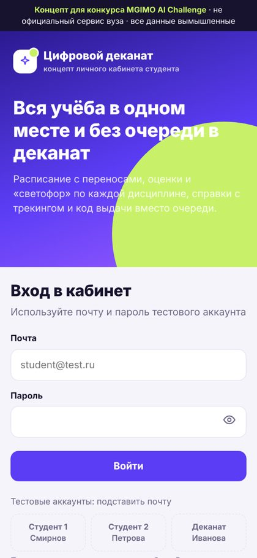 | 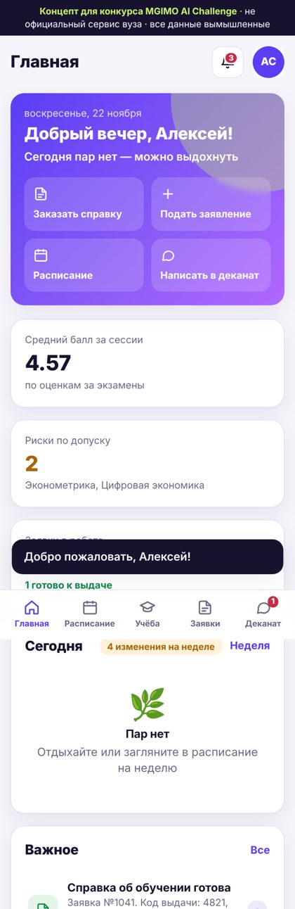 | 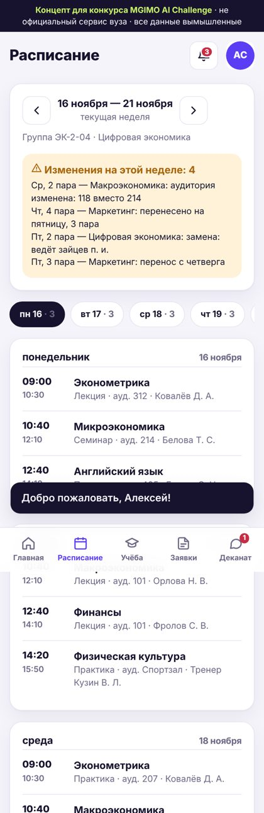 |

| Успеваемость: «светофор» | Заявление из профиля | Справка готова: код выдачи |
|---|---|---|
| 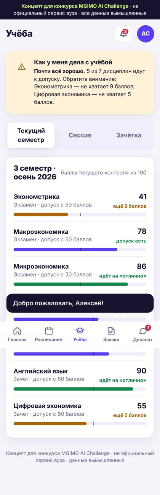 | 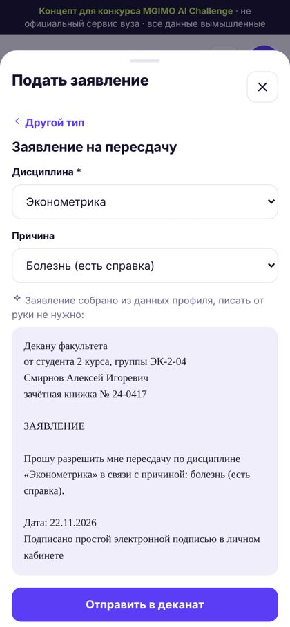 | 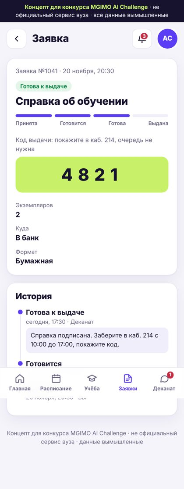 |

| Чат с деканатом | Чужая заявка по прямой ссылке: нет доступа |
|---|---|
| 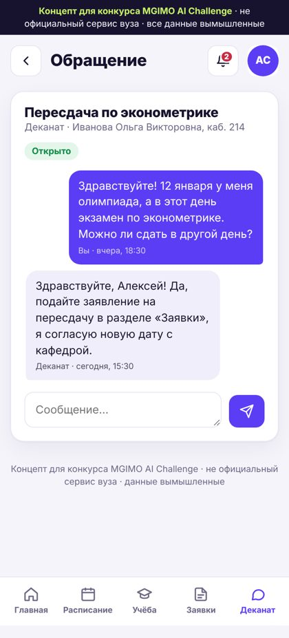 | 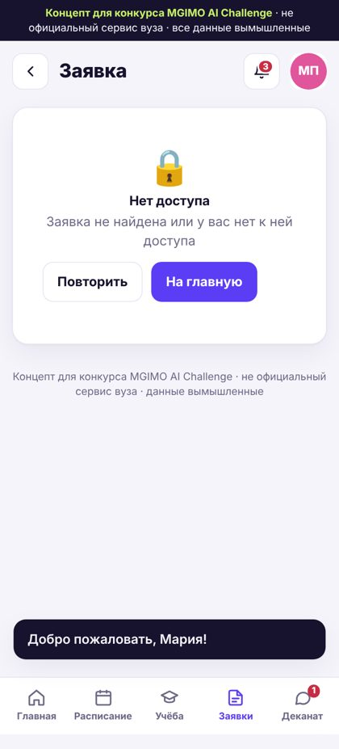 |

### Компьютер

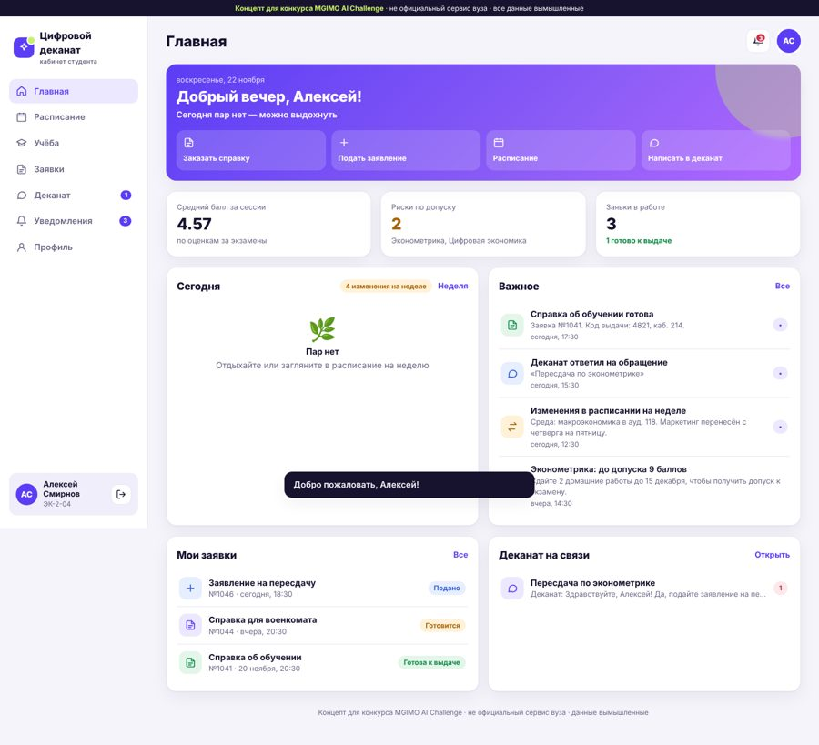
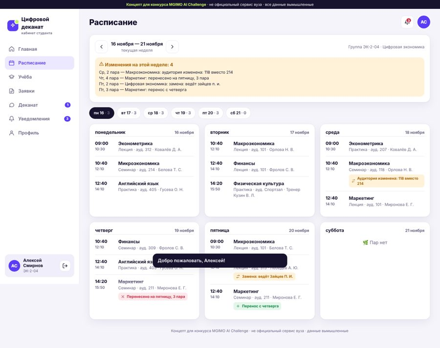
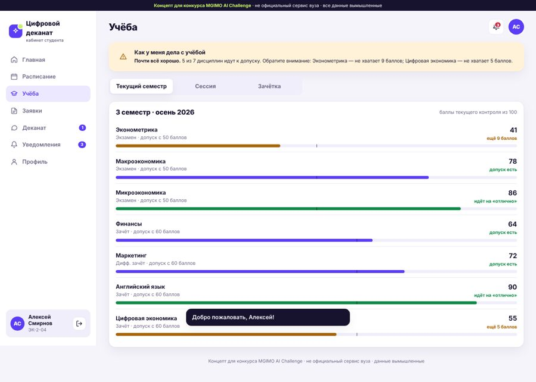
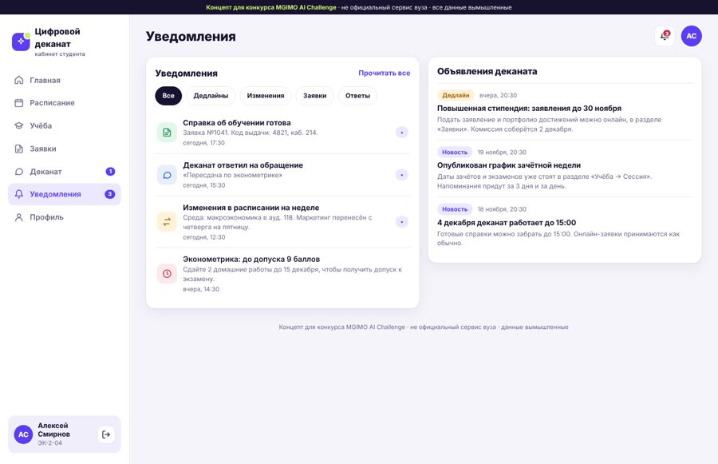

### Кабинет сотрудника деканата

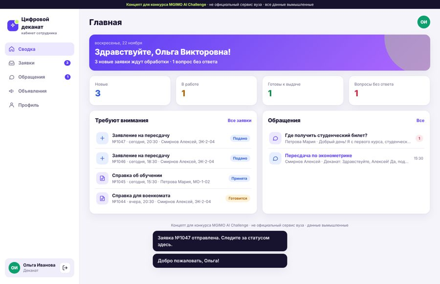
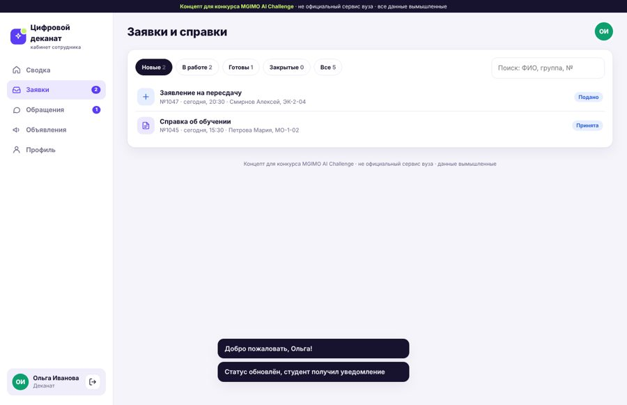

---

## 5. Как устроены вход, хранение данных и защита (простыми словами)

- **Вход.** Студент вводит почту и пароль. Кабинет не сравнивает пароль с образцом напрямую: он прогоняет введённый пароль через PBKDF2-SHA256 (100 000 повторов, у каждого пользователя своя случайная «соль») и сравнивает результат с сохранённым хешем. Сами пароли нигде не хранятся, ни в коде, ни в данных.
- **Сессия.** После входа создаётся случайный токен на 8 часов. Кнопка «Выйти» его удаляет. При смене пароля остальные сессии этого пользователя закрываются.
- **Защита от подбора.** После 5 неверных попыток вход для этой почты блокируется на минуту.
- **Разделение данных.** Экраны не читают данные сами, только через слой `API`. Каждая функция API сначала проверяет, кто вошёл, а потом отдаёт студенту только его расписание (по группе), его оценки, его заявки и обращения. Если вторая студентка откроет ссылку `#request-1041` на чужую заявку, она увидит «Нет доступа»: API не подтверждает даже, что такая заявка существует. Функции деканата (смена статусов, объявления) API выполняет только для роли «сотрудник».
- **Защита от внедрения кода.** Всё, что вводит пользователь (тексты обращений, комментарии), перед выводом экранируется.
- **Ключи.** Прототип не обращается ни к каким внешним сервисам и ИИ, поэтому ключей и токенов в коде нет.
- **Хранение.** В прототипе данные лежат в хранилище браузера (localStorage): после перезагрузки страницы всё сохраняется. Ограничение: у каждого члена жюри своя копия демо-данных. Заявка, поданная студентом, видна сотруднику деканата в том же браузере. Кнопка «Сбросить демо-данные» на странице входа возвращает всё к исходному состоянию.
- **Масштабирование.** Слой `API` написан как набор методов «запрос → ответ» с проверкой прав: `login`, `requests`, `setStatus` и так далее. Для реального запуска его методы переносятся на сервер (REST API и база данных, например PostgreSQL) без переделки интерфейса, и система работает на любое количество студентов.

---

## 6. Что сделали вручную

- Регистрация в конкурсе и заполнение профиля команды.
- Постановка задачи агенту и решения: что делать, где размещать, что важнее при нехватке времени.
- Создание репозитория `digital-dekanat` на GitHub и подключение к нему приложения Claude.
- Включение GitHub Pages в настройках репозитория.
- Проверка готового кабинета, заполнение формы и отправка работы на сайте конкурса.

Пароли и согласия в формах капитан вводил сам, агент этого не делал.
